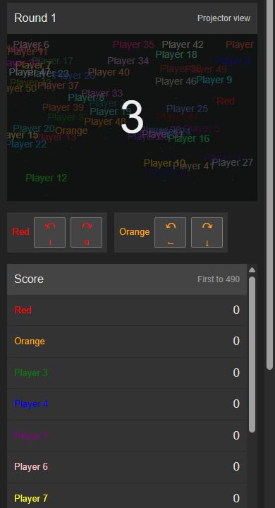

# Deep review — 10 October 2026

The current local source passes the final checks below after eight reproduced defect categories were repaired. There is no outstanding reproducible defect from this review in the tested local scenarios. This is strong evidence for those scenarios, not a universal guarantee or approval of continuous production reliability. The changes have not been deployed to either public website.

The review covered the authoritative simulation, WebSocket protocol and lifecycle, actual client callbacks, input prediction, Canvas rendering, responsive layout, build configuration, and both supplied public URLs. Existing changes were preserved, and no dependencies were added.

## Repairs

| Problem reproduced | Result after repair | Evidence |
| --- | --- | --- |
| An oversized frame from the rejected 201st socket killed the entire server | The rejected connection closes; the existing 200 sockets and host room survive | Permanent real WebSocket regression |
| Rapid Hydra use created coincident branches; uneven surviving families also collided after splitting | Spread follows actual angular separation, preserving separation through immunity expiry at every speed | Rapid 1→2→4→8→16, wall-pruned 4→3→6 and 16→2→4 regressions; steering probes |
| Trail owner indices at 65,536 overflowed 16-bit occupancy storage, making trails empty or misidentified | Both occupancy allocations retain 32-bit indices; exhaustion refuses a split before spending a charge | Boundary collision and rejection regressions |
| Blank draft names prevented reconnection | Rejoin uses the same trimmed names and fallbacks as ordinary joins | Actual App regression |
| A saved room overrode a newly opened invite | An explicit new invite wins; subsequent accepted-room reconnects still work | Actual App regression |
| Unaccepted roster edits could replace saved accepted seats during disconnect/reload | Saved membership follows accepted responses while newer drafts remain pending | Full-room rejection, intermediate acknowledgement, disconnect and reload regressions |
| A device owning zero seats could fail to recover an active room | Confirmed empty devices observe again and can add seats in the lobby; reload handles active-room refusal | Actual App regressions and a real WebSocket diagnostic |
| On a narrow screen, a 50-player scoreboard pushed steering controls far below the arena | Mobile controls appear directly below the arena, followed by the scoreboard | Browser measurement at 390 × 844 and screenshot below |

Fourteen permanent regression tests were added in this pass: seven simulation cases, six client cases, and one network crash case. The README now also describes the existing deathmatch rule correctly: every player reaching the target in the round qualifies, including unequal scores. The scoring mechanic was preserved.

The wider occupancy storage adds 8.59 MiB for a Large arena with 50 players. Hydra retains the existing limits of 16 living heads per player and 256 per room; effectively parallel branches are refused without charge deduction.

## Final checks

| Check | Observed result |
| --- | --- |
| Complete permanent suite | **100/100 passed**, no failures or skips, 4.20 seconds |
| TypeScript | `tsc --noEmit` passed |
| Production frontend build | Vite passed |
| Expanded simulation diagnostics | **29/29 passed** |
| Seeded 50-player exercise | 9 matches, 27 rounds, 44,735 ticks, 1,341 successful activations |
| Maximum living Hydra heads | 256 heads over 600 ticks; mean 0.343 ms/tick, p95 0.553 ms, maximum 1.253 ms |
| Additional steering | 12 pulsed/continuous Hydra steering cases passed |
| Gap geometry | 96 additional small-gap angle/subcell cases passed, plus every named gap size at all three speeds |
| Final real-time network stress | 50 independent player sockets plus a spectator; Large/Fast, mixed compression, 45 seconds and four rounds |
| Stress outcome | All 51 sockets open, zero protocol errors, 952 frames/client, maximum 59 published heads |
| Stress timing and memory | 58.89 ticks/second; event-loop p99 27.25 ms, maximum 137.23 ms; process RSS 186 MB |
| Controlled browser checks | Local room creation/countdown, Dark knight blackout, Hydra growth and Shoot holes charge/effect changes; mobile layout |

The simulated clients and server shared one computer. These timing and memory measurements do not measure hosting capacity or the drawing performance of 50 physical browsers. The maximum-head diagnostic measures simulation work, not end-to-end frame delivery. Decoded JSON totals are not compressed wire traffic.

One earlier combined run passed 99 tests and timed out joining the 50 independent sockets during an approximately 135-second execution delay. The cause was not established. The isolated network suite then passed 12/12, and the quiet final integrated run passed all 100 without a source change. The anomalous log is preserved; the reruns do not prove its cause.

## Ability coverage

All fourteen choices were exercised in the simulation and shared-network tests. The real-time stress assigned every choice across its fifty players; this does not enumerate every pairwise combination or input timing.

| Ability | Scenarios exercised |
| --- | --- |
| No superpower | Rejected activation, ordinary movement/scoring, no power recharge |
| Run faster | Speed/steering multiplier, exact expiry, charge rejection, swept collision between ticks |
| Run slower | Reduced speed, expiry, gaps, Hydra separation at relaxed speed |
| Jump | Charge use, skipped teleport path, trail crossing, landing collisions |
| Invisible | Timed immunity, hidden head, borders/trails, expiry, no invisible pickup trail |
| Vertical bar | Authoritative trail creation and same-tick draw/erase ordering |
| Cross walls | Wrap discontinuity, landing collisions, final-charge exhaustion |
| Dark knight | Shared three-second blackout, exact expiry, round cleanup, Canvas retains hidden drawing |
| Hydra | All living branches steer; rapid/uneven splits, both caps, trail history, owner-based scoring, index bounds |
| Reverse | End swap, discontinuity, own-trail immunity, landing collisions |
| Square head | One right-angle turn per input edge, expiry, paused-input rejection, prediction |
| Chuck Norris | Passive behavior, white trail retention, no ordinary charge gains |
| Shoot holes | Authoritative cell erasure, chronology, pending frames, late snapshots and resized Canvas |
| Random | One resolution per round, valid resolved abilities, shared state |

Other exercised features include all map presets and roster scaling; six local players with unique controls; Y/Z layouts and rebinding; simultaneous touch pointers and cancellation; blur/pause input release; host-only settings and phase actions; forced power rules and rapid overlapping edits; countdown, pause/resume, rounds, scoring and deathmatch disconnects; spectator snapshots; reconnect grace, host transfer, duplicate-tab replacement and saved-preference recovery; private monotonic input acknowledgements; malformed/flooded messages, slow readers, compression and snapshot deadlines; and synthetic 15/30 ms RTT with jitter and bounded prediction after missing updates.

## Both public websites

[Vercel](https://achtung-die-kurve-kohl.vercel.app/) and [Render](https://achtung-die-kurve.onrender.com/) were opened in separate browser tabs. A Vercel-created test room could be spectated from Render; countdown, round and score state were shared. This confirms shared-backend operation for that observed session. Hosted power activation was not established in this pass; controlled local browser checks supplied that evidence instead. Both sites returned HTTP 200 from `/health` at 12:31:56 UTC.

Later, that hosted room became unavailable and both tabs displayed “Room not found” after reconnecting. The cause remains unknown. The current source can delete an empty room after all devices disconnect beyond the 30-second grace period; replacing the backend process also loses its rooms. No provider restart history was available to distinguish these explanations. Continuous hosted stability is therefore **unverified**.

The public sites served different frontend asset hashes and did not show the current local map-size selector. Version parity with the repaired source is unverified. Passing local tests cannot establish that these fixes are running publicly.

## Supported hosting boundary and unverified scenarios

The server limits are 50 players per room, six players per device, 80 devices per room, 200 live connections overall, and 100 rooms. These limits bound input and allocation; they are not a promise that 100 simultaneously active rooms fit a particular cloud plan.

The authoritative backend requires one instance because rooms, sessions and simulation state live in memory. A backend restart/redeploy ends active matches. Multiple backend instances require room routing and shared state. Vercel frontends can use Render's persistent backend through the build-time `VITE_GAME_SERVER_URL`; the repository does not verify actual provider dashboard settings. Changing a runtime variable does not rewrite an existing frontend build.

No destructive production load, provider restart/scaling experiment, overnight soak, physical phone multitouch, keyboard rollover, school Wi-Fi, or exhaustive browser/OS/hardware/network permutation was checked. Six local players on a narrow phone may still require scrolling. The mobile ready screen's keyboard focus follows DOM order, which differs from the reordered visual position of touch controls.

The confidence statement is: the reviewed local source passes the finite coverage above; public deployment and continuous reliability still need verification. A claim of “100% in all scenarios” would exceed the evidence.

## Evidence

Permanent cases are in `tests/server-game.test.ts`, `tests/server-network.test.ts`, and `tests/client-app.test.ts`; run `npm test`, `npx tsc --noEmit`, and `npm run build` to repeat the standard gates. Raw local scripts and outputs remain in the ignored `.audit/` folder, including `final-suite.log`, `final-suite-delayed.log`, `final-typecheck.log`, `final-build.log`, `game-rules/`, `client-review/`, and `multiplayer-deploy/`.

The screenshot shows the repaired phone layout in a 50-player countdown, with both owned players' controls above the scoreboard:

